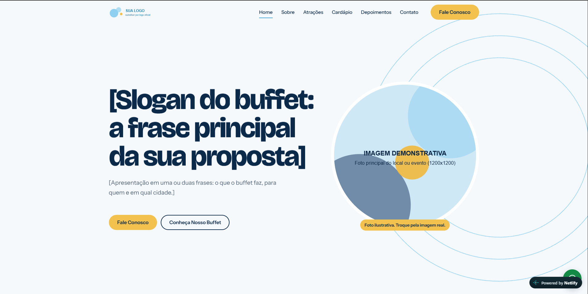

# Buffet Landing Page

A modern and responsive landing page developed for a buffet business, designed to showcase its services, event attractions, menu, and customer testimonials.

## 🌐 Live Demo

[View Live Website](https://modelo-landingpage-buffet.netlify.app/)

## 📸 Preview



## 🚀 Features

- Responsive layout for desktop and mobile devices
- Modern and elegant user interface
- Navigation bar with smooth scrolling
- About section
- Event attractions showcase
- Menu section
- Customer testimonials
- Location and contact information
- WhatsApp integration for direct contact
- Interactive elements and animations

## 🛠️ Technologies

- HTML5
- CSS3
- JavaScript
- GSAP

## 📂 Project Structure

```text
├── index.html
├── css/
│   └── style.css
├── js/
│   └── script.js
├── assets/
│   └── images/
└── README.md
```

## 🎯 Purpose

This project was created as part of my web development portfolio, focusing on responsive design, user experience, and front-end development practices.

## 👨‍💻 Developer

**Miguel Santos**  
Web Developer

- GitHub: [@miguelsantos28](https://github.com/miguelsantos28)

---

*Developed with HTML, CSS, and JavaScript.*